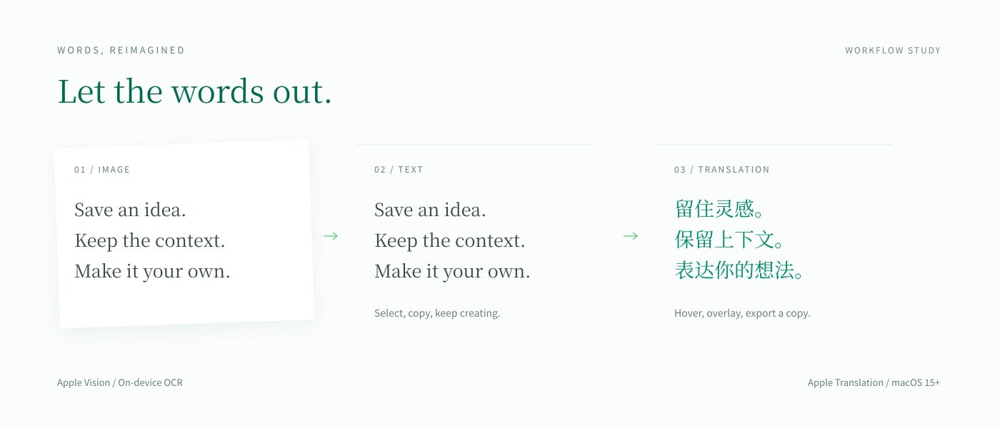

<p align="center">
  
</p>

<br>

<div align="center">

[简体中文](README.md) &nbsp; / &nbsp; [English](README.en.md)

</div>

<p align="center">
  
</p>

<div align="center">

A free, open-source capture and editing tool for Mac and iPhone/iPad.<br>No account. All features free, with no time limit.

**[Download for Mac](https://github.com/Poseima/picelf-open/releases/latest)** &nbsp; · &nbsp; [Installation](docs/installation.md) &nbsp; · &nbsp; [Build from source](#build) &nbsp; · &nbsp; [Feedback](https://github.com/Poseima/picelf-open/issues)

</div>

<br>

## What would you like to keep?

Save a long page as one image, explain a screenshot with arrows and notes, pin references beside your work, or extract and translate text from an image. Picelf brings capture and the work that follows into one tool.

<details>
<summary>Features at a glance · Capture, edit, text and cross-device workflows</summary>

| Feature | What you can do | Explore |
| :--- | :--- | :--- |
| **Capture & scrolling screenshots** | Capture a window or region, scroll, stitch incrementally and preview a long image | [Scrolling capture](#scrolling) |
| **Image editing** | Arrows, shapes, text, mosaic, stickers, cropping, subject extraction and custom watermarks | [The editor](#editor) |
| **OCR & translation** | Extract text, view translations on hover, overlay translated text and export translated copies | [Text workflow](#ocr) |
| **Desktop pins & canvas** | Keep references on top, bind them to a window or display, and arrange multiple images on a canvas | [Desktop pins](#pins) |
| **Workbench** | Background stitching jobs and a shared home for capture and recording history | [More workflows](#workflows) |
| **Screen recording** | Record a window or region, pause and resume, with optional microphone audio | [More workflows](#workflows) |
| **iPhone / iPad** | Import images and videos, collect broadcast frames, stitch, edit and export | [Platform support](#platforms) |
| **Mac / iPad relay** | Pair locally, annotate live, edit text and return images | [More workflows](#workflows) |

</details>

<br>

## Meet Picelf

<a id="scrolling"></a>

### 01 · A whole page in one image

Choose a window or region, scroll through its content, preview the capture and stitch frames into a long image. Useful for pages, PDFs and conversations that extend beyond the screen.

<br>

<p align="center">
  
</p>

<br>

*Window & region capture · Scrolling screenshots · Incremental stitching · Background workbench*

<br>

<a id="editor"></a>

### 02 · Capture it. Explain it.

Point out details with arrows and text, hide parts you do not want to share with mosaic, then crop, add stickers or extract a subject. Watermarks are optional, with content and styling you control.

<br>

<p align="center">
  
</p>

<br>

*Annotations & text · Mosaic · Cropping & subject extraction · Stickers · Optional watermarks*

<br>

<a id="ocr"></a>

### 03 · Put the text in your images to work

Extract image text with Apple Vision and copy it for further editing. On macOS 15+, translate with Apple Translation, view translations on hover or overlay them, and export a translated copy.

<p align="center">
  
</p>

*This workflow illustration uses generic sample text. Translation may require an initial download of Apple's language packs.*

*Multilingual OCR · Hover translation · Translation overlays · Translated image export*

<br>

<a id="pins"></a>

### 04 · Keep your references in reach

Pin captures beside your design, code or notes. Bind a pin to a window or display, adjust its opacity, or arrange several images on a canvas.

<br>

<p align="center">
  
</p>

<br>

*Always-on-top pins · Window & display binding · Adjustable opacity · Multi-image canvas*

*The showcase images come from Picelf's Chinese-interface marketing assets. The app interface supports Chinese and English.*

<br>

<a id="workflows"></a>

## Beyond a screenshot

| Workflow | How it works |
| :--- | :--- |
| **Capture → Workbench → Edit** | Stitch long images in the background, review jobs and history, then open the result to keep editing. |
| **Screen → Video** | Record a window or region, enable the microphone if needed, pause and resume, then export the recording. |
| **iPhone / iPad → Long image** | Import images or videos, or collect frames through broadcast capture, then stitch and export. |
| **Mac ↔ iPad** | Pair over the local network, annotate live, edit text and return images to your Mac. |

<a id="platforms"></a>

## Platform support

| Platform | Requirements | Availability |
| :--- | :--- | :--- |
| **Mac · Apple Silicon / Intel** | macOS 14+; image translation requires macOS 15+ | [Mac Releases](https://github.com/Poseima/picelf-open/releases) or build from source |
| **iPhone / iPad** | iOS / iPadOS 16+ | Complete source available; follow the [iOS build guide](docs/ios-build.md) to install |
| **Mac / iPad relay** | Picelf running on both devices, connected over the local network | Pair and confirm the connection in the app |

## Download and install

Download `Picelf-<version>-universal.dmg` from [Releases](https://github.com/Poseima/picelf-open/releases), open it and drag **Picelf** into **Applications**. One installer supports Apple Silicon and Intel.

> Download the DMG installer from Releases. GitHub Source code archives contain source, not an installable application.

Grant Screen Recording, Accessibility and optional Microphone permissions as needed. Official builds can check for updates from settings or the menus; you decide when to install, and settings and history remain. Older builds without the updater need one overwrite installation first. See [installation and permissions](docs/installation.md).

<a id="build"></a>

## Build from source

Install Xcode 16+ with the macOS 15 SDK, Command Line Tools and [XcodeGen](https://github.com/yonaskolb/XcodeGen):

```bash
brew install xcodegen
git clone https://github.com/Poseima/picelf-open.git
cd picelf-open
xcodegen generate
open Picelf.xcodeproj
```

Select the `Picelf` scheme, choose your development team in Signing & Capabilities, and run with Cmd+R. Use signed builds for privacy-permission testing; run `./scripts/ci/check.sh mac-build` for compilation only.

See the [iOS build guide](docs/ios-build.md) for device, broadcast extension and App Group setup.

## Local first. Open to everyone.

Captures, recordings and editing data stay on your device. Relay transfers content between paired devices over the local network. The app has no analytics, advertising or application account, and no feature trial period. Translation may initially contact Apple to download language packs.

[Privacy](docs/privacy.md) · [Contributing](CONTRIBUTING.md) · [Releasing](docs/releasing.md) · [MIT license](LICENSE) · [Third-party notices](THIRD_PARTY_NOTICES.md)

Share bugs and ideas through [Issues](https://github.com/Poseima/picelf-open/issues), or contribute a Pull Request. Remove personal information before sharing screenshots or recordings.
