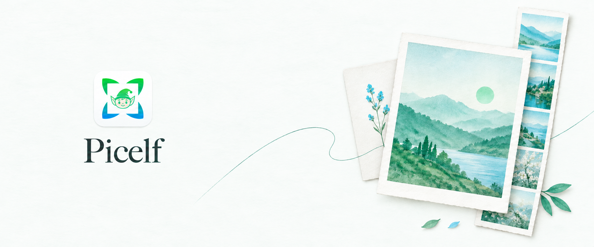
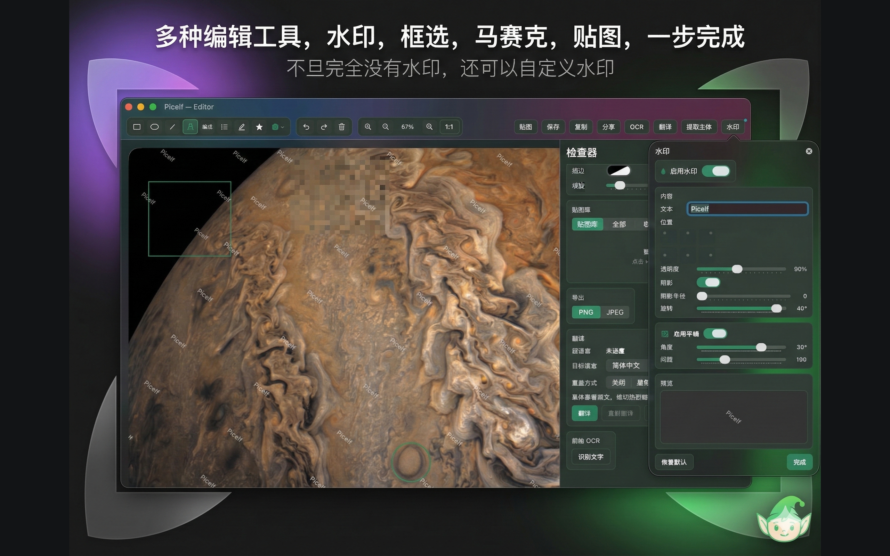
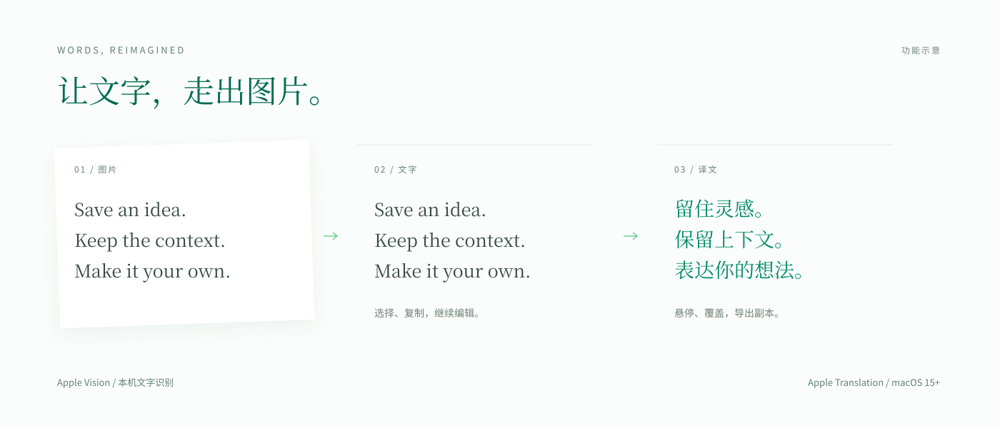
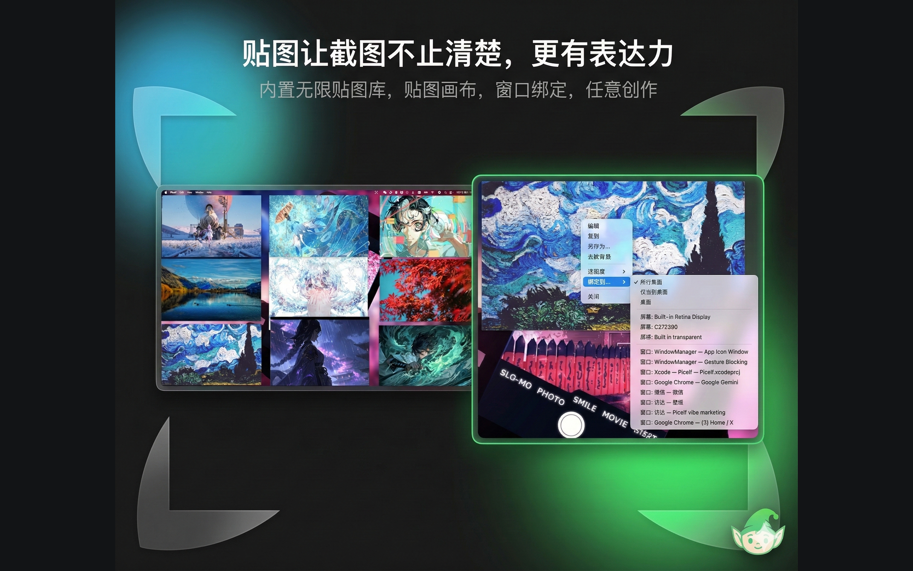

<p align="center">
  
</p>

<br>

<div align="center">

[简体中文](README.md) &nbsp; / &nbsp; [English](README.en.md)

</div>



<div align="center">

免费的开源截图、长图拼接与编辑工具，支持 Mac 和 iPhone/iPad。<br>无需账号，全部功能没有使用期限。

**[下载 Mac 版](https://github.com/Poseima/picelf-open/releases/latest)** &nbsp; · &nbsp; [安装说明](docs/installation.md) &nbsp; · &nbsp; [从源码构建](#build) &nbsp; · &nbsp; [反馈建议](https://github.com/Poseima/picelf-open/issues)

</div>

<br>

## 你想留下什么？

把长网页保存成一张图，为截图补上箭头和说明，把参考图贴在桌面上，或直接提取、翻译图片里的文字。Picelf 把截取之后的整理与表达也放在同一个工具里。

<details>
<summary>功能速览 · 截图、编辑、文字与跨设备工作流</summary>

| 功能 | 可以做什么 | 了解更多 |
| :--- | :--- | :--- |
| **截图与长图** | 窗口/区域截图、滚动捕获、增量拼接与长图预览 | [长截图展示](#scrolling) |
| **图片编辑** | 箭头、框选、文字、马赛克、贴纸、裁剪、主体提取与自定义水印 | [编辑器展示](#editor) |
| **OCR 与翻译** | 提取文字、悬停查看译文、译文覆盖与翻译副本导出 | [文字工作流](#ocr) |
| **桌面贴图与画布** | 将图片置顶作参考，绑定窗口或屏幕，用画布组织多张图片 | [贴图展示](#pins) |
| **工作台** | 后台拼接任务、截图与录屏历史，集中管理捕获结果 | [更多工作流](#workflows) |
| **屏幕录制** | 窗口/区域录制、暂停与继续，可选麦克风音频 | [更多工作流](#workflows) |
| **iPhone / iPad** | 图片与视频导入、广播录屏提帧、拼接、编辑与导出 | [平台支持](#platforms) |
| **Mac / iPad 接力** | 本地配对、实时标注、可编辑文字与图片回传 | [更多工作流](#workflows) |

</details>

<br>

## 看看 Picelf

<a id="scrolling"></a>

### 01 · 一页内容，一张长图

选定窗口或区域，滚动捕获内容，边截边预览，再把多帧拼成一张长图。适合保存网页、PDF 或聊天记录等需要滚动查看的内容。

<br>

<p align="center">
  
</p>

<br>

*窗口/区域捕获 · 滚动长截图 · 增量拼接 · 后台工作台*

<br>

<a id="editor"></a>

### 02 · 截完，就能说明白

用箭头与文字标出重点，用马赛克遮住不想分享的部分，再裁剪、添加贴纸或提取主体。水印由你决定是否启用，也可以自定义内容与样式。

<br>

<p align="center">
  
</p>

<br>

*标注与文字 · 马赛克 · 裁剪与主体提取 · 贴纸 · 可选水印*

<br>

<a id="ocr"></a>

### 03 · 图片里的文字，也能继续使用

通过 Apple Vision 提取图片文字，复制后继续整理；在 macOS 15+ 使用 Apple Translation 翻译，选择悬停查看或译文覆盖，并导出翻译副本。



*上图为使用通用示例文本制作的功能示意。翻译首次使用可能需要下载系统语言包。*

*多语种 OCR · 悬停翻译 · 译文覆盖 · 翻译副本导出*

<br>

<a id="pins"></a>

### 04 · 把参考图留在手边

将截图贴在桌面上，对照设计、代码或资料；按需绑定到窗口或屏幕，调整透明度，或在画布里组织多张图片。

<br>

<p align="center">
  
</p>

<br>

*桌面置顶 · 窗口/屏幕绑定 · 透明度调节 · 多图画布*

*以上展示图来自 Picelf 的中文界面营销素材；应用界面支持中文与英文。*

<br>

<a id="workflows"></a>

## 不止一张截图

| 工作流 | 如何使用 |
| :--- | :--- |
| **捕获 → 工作台 → 编辑** | 让长图在后台拼接，在工作台查看任务与历史，再打开结果继续编辑。 |
| **屏幕 → 视频** | 录制窗口或区域，按需启用麦克风，暂停后继续，再导出录制结果。 |
| **iPhone / iPad → 长图** | 导入图片或视频，也可以通过广播录屏采集帧，拼接并导出结果。 |
| **Mac ↔ iPad** | 在本地网络配对后，实时接力标注、编辑文字，并将图片回传到 Mac。 |

<a id="platforms"></a>

## 平台支持

| 平台 | 系统要求 | 获取方式 |
| :--- | :--- | :--- |
| **Mac · Apple Silicon / Intel** | macOS 14+；图片翻译需要 macOS 15+ | [Mac Releases](https://github.com/Poseima/picelf-open/releases) 或从源码构建 |
| **iPhone / iPad** | iOS / iPadOS 16+ | 当前提供完整源码，按 [iOS 构建指南](docs/ios-build.md) 自行安装 |
| **Mac / iPad 接力** | 两端运行 Picelf，并可通过本地网络连接 | 在应用内配对并确认连接 |

## 下载与安装

在 [Releases](https://github.com/Poseima/picelf-open/releases) 下载 `Picelf-<版本>-universal.dmg`，打开后将 **Picelf** 拖入 **Applications**。同一个安装包支持 Apple Silicon 和 Intel。

> 首个正式 Release 尚未发布，安装包将在发布后提供。GitHub 的 Source code 压缩包是源码，不能直接安装。

根据使用场景授予屏幕录制、辅助功能及可选麦克风权限。更新时退出应用后覆盖安装，设置与历史记录保留。详见[安装与权限说明](docs/installation.md)。

<a id="build"></a>

## 从源码构建

需要 Xcode 16+（包含 macOS 15 SDK）、Command Line Tools 和 [XcodeGen](https://github.com/yonaskolb/XcodeGen)。

```bash
brew install xcodegen
git clone https://github.com/Poseima/picelf-open.git
cd picelf-open
xcodegen generate
open Picelf.xcodeproj
```

选择 `Picelf` scheme，在 Signing & Capabilities 设置自己的开发团队，再按 Cmd+R。使用签名构建测试系统权限；纯编译检查运行 `./scripts/ci/check.sh mac-build`。

iPhone/iPad 真机、广播扩展与 App Group 配置见 [iOS 构建指南](docs/ios-build.md)。

## 本地优先，开放使用

截图、视频与编辑数据保存在设备本地；接力仅在配对设备间通过本地网络传输。应用不集成分析或广告服务，不需要应用账号，全部功能没有试用期限。翻译首次使用可能由系统联网下载语言包。

[隐私说明](docs/privacy.md) · [贡献指南](CONTRIBUTING.md) · [发布指南](docs/releasing.md) · [MIT 许可](LICENSE) · [第三方声明](THIRD_PARTY_NOTICES.md)

欢迎通过 [Issues](https://github.com/Poseima/picelf-open/issues) 分享问题与建议，或提交 Pull Request。分享截图或录屏前，请先移除个人信息。
